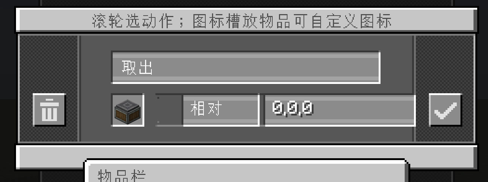

# 可编程动力臂 · Create Sequenced Mechanical Arm

给 [机械动力（Create）](https://github.com/Creators-of-Create/Create) 加一种**可编程的机械臂**：
在「操作表」上写好一串操作，插进臂里，它就会一条一条地执行 —— 取物、放入、卸货、组装、攻击、挖掘、
使用、等待、收发红石链接信号。



> 设计取向：**专注于动力臂本身，尽量不添加额外内容**。不新增方块族、不做跨模组适配，全部功能都长在这一条臂和它的操作表上。

**仓库**：<https://github.com/Ling-awa/CreateSmartMechanicalArm> —— 从 [Releases](https://github.com/Ling-awa/CreateSmartMechanicalArm/releases) 拿 jar，或按下面的「构建」自己产一个；问题与建议请提到 [Issues](https://github.com/Ling-awa/CreateSmartMechanicalArm/issues)。

**还没做的功能与计划**：见 [`ROADMAP.md`](ROADMAP.md)（过滤操作、操作导入方块、从臂中复制操作、美术资源……细节仍在商榷）。

---

## 这是什么

原版动力臂只能"从 A 拿到 B"。这条臂多了一张**可编辑的操作表**：

1. 拿到「可编程动力臂」放好（需要给它转速，和原版动力臂一样）——配方尚未添加，目前从创造模式物品栏里取；
2. 手持「操作表」**潜行右键**切换模式，可以对着方块右键把目标位置录进去，ALT + 滚轮选动作；
   在**编辑模式**里也是 **ALT + 滚轮** —— 换正在编辑的那条任务；
3. 把操作表插进臂里，臂就会按条目一步步执行，护目镜能看它跑到哪一步、以及失败原因。

**15 种操作**：取出 / 放入 / 卸货 / 组装 / 攻击 / 挖掘 / 使用 / 潜行使用 / **过滤** / 等待 / 等红石 / 收发信号 / 调用 / 退出 / 抛错。

- **过滤**：拿一个**幽灵物品**当过滤器，判断**臂手上的物品**或**某个外部容器**（只看容器第一格）。
  过滤规则**完全用机械动力本体的那套**：幽灵槽里放普通物品 = 按物品比；
  放 `create:filter`（列表过滤，可加标签项、可设黑白名单、可比 NBT）、`create:attribute_filter`（属性过滤）、
  `create:package_filter`（包裹过滤）就用它们各自的规则。比中走**成功后**、没比中走**失败后** ——
  配上"跳转到任务"就能做分流。空过滤器 = 匹配一切；被比的那边没有物品则总是失败。

- **循环**：一直重复 / 计次 / 直到失败；**出口**：失败后、超时后、成功后各自可以"跳过"或"跳转"到指定任务 ——
  这样就能拼出流水线、分支和子程序（「调用」可以调另一张任务）。
- **调用次数**（写在「调用」这条操作上）：`0–64`，缺省 1，**`0` = 无限循环** —— 轮次归**调用点**管，
  被调任务自己的「循环」对它无效（否则就是"调用 ×3 × 自己循环 ×2"，谁都算不清）。
- **坐标**：条目坐标全是**相对执行它的那条臂**的偏移（`0 0 0` = 那条臂自己），
  所以换一条臂、换一个位置，程序的行为都不变。卡上另存一个**原点**（中键对着方块设，
  世界里画成蓝色方框），它只用于**录制**（`世界坐标 − 原点`）与渲染，不参与运行。
  任务列表页底部还有「原点坐标」「坐标偏移」两颗按钮：前者改/清原点，后者把**所有**条目的偏移一起搬。
- **卸货**支持"一次 / 直到空"、"一组 / 尽可能多"；**等待**支持刻/秒/分，也能"等通电 / 等断电"。
- **收发信号**：臂自己就是红石链接的发射端，可以"发通电 / 发断电 / 中断"，也能"收"着等。
- **传送带**：取出时物品一进入判定范围就**原地按住**等手臂；组装时等物品**自己走到格子中间**再按住，
  在物品上原地加工（不会把它搬到别处）。

### `.sma` 脚本语言（进阶）

除了 GUI 编辑器，操作表也能以**文本**形式存在卡上 —— 格式是面向本模组的一套小语言，
带注释（注释就是条目备注）、简写物品 ID（`minecraft:dirt`）与完整 SNBT 两种写法。

**文本就是盘上的唯一形式**：卡片与臂里存的都是这串文本，编译结果只活在内存里 —— 插卡、载入世界时
编译一次（不是每刻解析）。于是存档可读、可 diff、可手工修，**存得下的程序也从"几十条"变成"几百到几千条"**
（取决于备注写多长，实测数字见 [路线图](ROADMAP.md)）。用 `/sma code import` 导进来的脚本会**原样保留排版**；
用 GUI 改过之后再存，文本会被重新生成为规范格式（注释=备注，所以内容不丢）。

> ⚠️ **不兼容提醒**：0.1.0 之前（含测试版）盘上存的是编译结果。本版起只认文本，
> **旧存档里已有的程序不会被读出来**（卡片与臂都一样）—— 重进世界后它们是空的，
> 用编辑器重录、或把脚本 `/sma code import` 回去即可。

---

## 环境要求

| 项目 | 版本 |
|---|---|
| Minecraft | **1.21.1** |
| NeoForge | **21.1.251**（声明范围 `[21,)`） |
| Create（机械动力） | **6.0.10-280**（声明范围 `[6.0.10,)`，必需前置） |
| Java | **21** |

## 构建

```bash
./gradlew build        # 产物在 build/libs/create_sequenced_mechanical_arm-<版本>.jar
./gradlew runClient    # 起一个带 Create 的开发客户端（首次会下载依赖）
./gradlew runServer -PsmaSelfTest=true   # 无头自检：跑完断言后自动关服
```

把 `build/libs/` 里的 jar 丢进 `mods/` 即可（同时要有 Create 与 NeoForge）。

---

## 关于源码注释里的 `§7.x` / 「决策 N」，以及提交信息中的PLAN.md

源码与提交信息里经常引用形如 `§7.24`、`§13`、决策 `92` 的编号 —— 它们指向一份**本机维护、
未随仓库发布**的设计与实测记录（逐轮记录每条行为的理由、与上游 Create 源码的逐条比对、
以及每个断言是怎么被反证过的）。这份记录不公开，所以那些编号在本仓库里查不到；
README 与源码注释本身已经写清了每处行为的**结论**，只是省去了推导过程。

## 许可与致谢

- 本模组以 **MIT** 许可发布（见 [`LICENSE`](LICENSE)）。
- 依赖并面向 **[Create（机械动力）](https://github.com/Creators-of-Create/Create)**，其许可为 MIT，
  版权归 simibubi 及其贡献者所有。
- 手臂的两节 IK 角度解算数值与 Create 的 `ArmAngleTarget` 一致（见
  `SequencedArmAngleTarget` 的类注释），依据 MIT 许可使用并注明来源。

---

## English

An addon for **Create** that adds a **sequenced mechanical arm**. Write a list of operations on an
*operation table*, insert it into the arm, and the arm performs them step by step: take, deposit,
unload, deploy, attack, mine, use, sneak-use, wait, wait-for-redstone, send/receive a redstone-link
signal, call a subtask, return, throw.

> The Chinese name is **可编程动力臂**, following Create's own wording for the Sequenced Gearshift
> (「可编程齿轮箱」); the English name follows Create's English convention (*Sequenced*).

- **Requires**: Minecraft 1.21.1, NeoForge 21.1.251, Create 6.0.10-280, Java 21.
- **Build**: `./gradlew build` → jar in `build/libs/`.
- **Design note**: this addon deliberately adds nothing beyond the arm itself — no new block families,
  no cross-mod integration.
- **License**: MIT. Create is MIT, © simibubi and contributors; the arm's two-segment IK numbers match
  Create's `ArmAngleTarget` (see the class comment in `SequencedArmAngleTarget`).


本篇README.md主要由AI生成。
